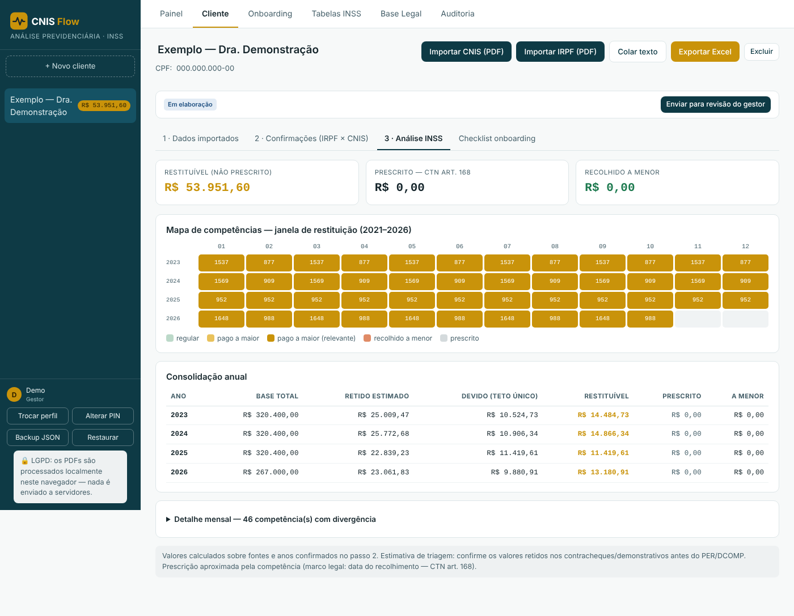
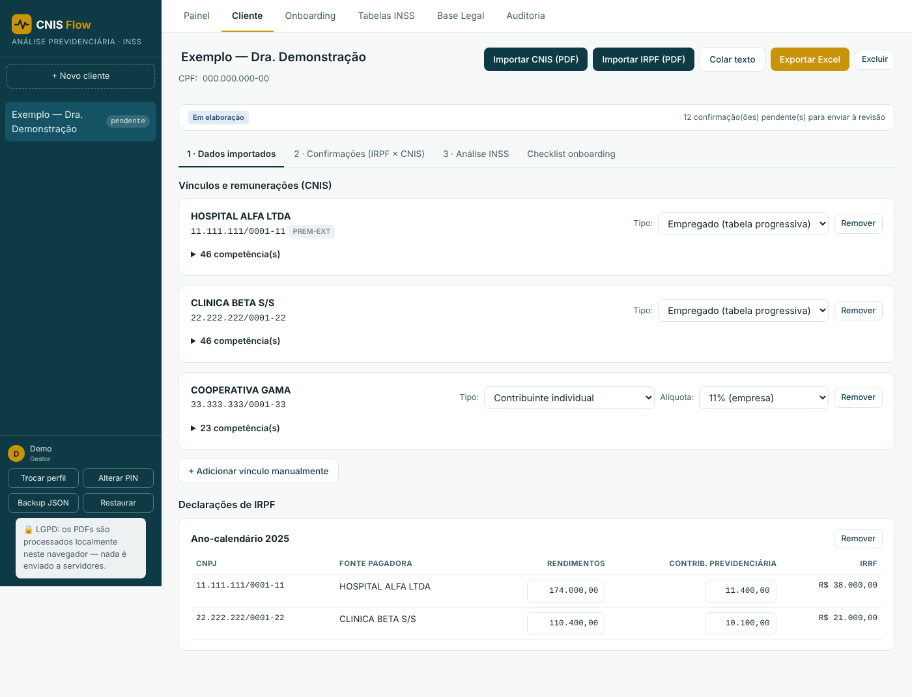
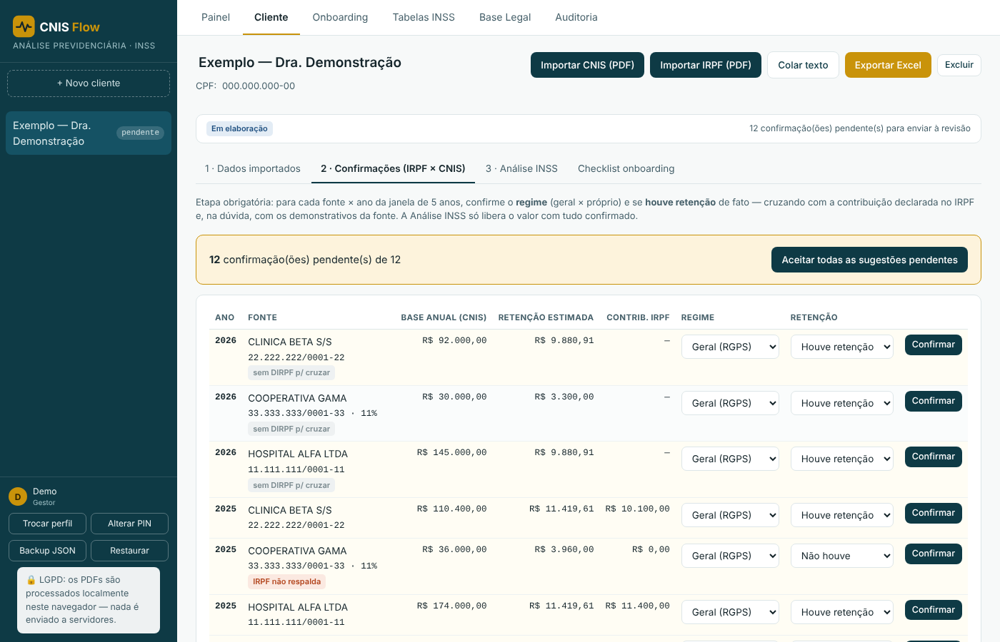

# CNIS Flow

Aplicativo web para analisar contribuições ao INSS pagas acima do teto por profissionais com mais de um vínculo, e estimar o valor que pode ser pedido de volta à Receita Federal por PER/DCOMP.

*Imagens da versão de demonstração, com dados inteiramente fictícios.*

## O problema

Médicos costumam trabalhar em vários lugares ao mesmo tempo: dois hospitais com carteira assinada, plantões como autônomo, cooperativas. Cada fonte desconta INSS como se fosse a única, mas a lei limita a contribuição total ao teto do salário de contribuição. O que passa do teto foi pago a maior e pode ser restituído, desde que dentro do prazo de cinco anos.

Fazer essa conta à mão exige cruzar o extrato do CNIS com as declarações de imposto de renda, mês a mês e fonte a fonte, separar quem contribui para regime próprio (servidor público) e confirmar se a retenção realmente aconteceu. É trabalho lento e fácil de errar, e um erro aqui significa prometer ao cliente uma restituição que não existe.

## O que o app faz

- **Leitura dos PDFs** do extrato CNIS e da declaração de IRPF, com extração dos vínculos, das remunerações por competência e das contribuições declaradas por fonte.
- **Cálculo multi-vínculo**: aplica a tabela progressiva para empregados e as alíquotas de contribuinte individual, soma as fontes e compara com o teto de cada competência.
- **Confirmação obrigatória** fonte a fonte e ano a ano. O analista confirma o regime (geral ou próprio) e se houve retenção, cruzando a estimativa com o que foi declarado no IRPF. O app sugere as respostas e só libera o valor final com tudo confirmado.
- **Mapa de competências** da janela de restituição, mostrando onde houve pagamento a maior, recolhimento a menor ou prescrição (CTN, art. 168).
- **Consolidação anual** com base total, valor retido estimado, valor devido pelo teto único e valor restituível.
- **Fluxo de trabalho com dois perfis**: o analista importa e confirma; o gestor revisa, aprova e registra a transmissão do PER/DCOMP. Ações sensíveis exigem PIN do gestor.
- **Trilha de auditoria** de cada ação, **exportação para Excel** como memória de cálculo e **backup criptografado** (AES-256-GCM).
- Abas de referência com as tabelas do INSS e a base legal usada em cada regra.

### Dados importados

### Confirmações (IRPF × CNIS)

## Como foi feito

- HTML, CSS e JavaScript em um único arquivo, sem servidor. A leitura dos PDFs usa pdf.js e a exportação usa SheetJS.
- Tudo é processado localmente no navegador. Os documentos dos clientes não saem do computador, o que importa para a LGPD.
- Construído com apoio de IA generativa, a partir da legislação previdenciária (Lei 8.212/1991), das regras de restituição da Receita Federal e de casos reais de análise.
- O código-fonte não está publicado porque o app foi desenvolvido em contexto profissional. Posso apresentá-lo em funcionamento numa entrevista.

## Autor

Josias Lessa · economista (UFRGS) e graduando em Ciências Contábeis (UFRGS)
